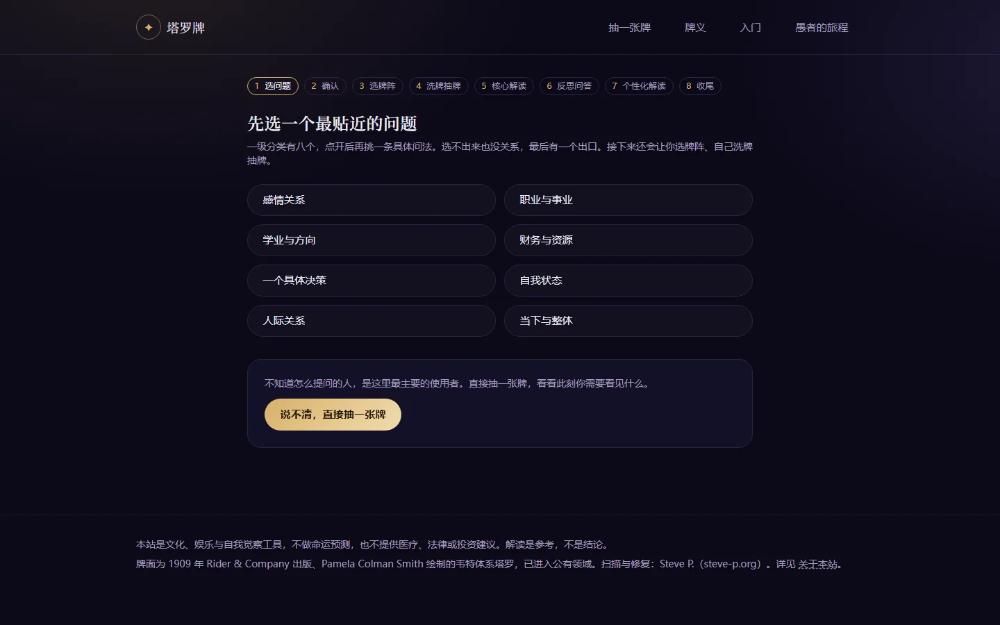
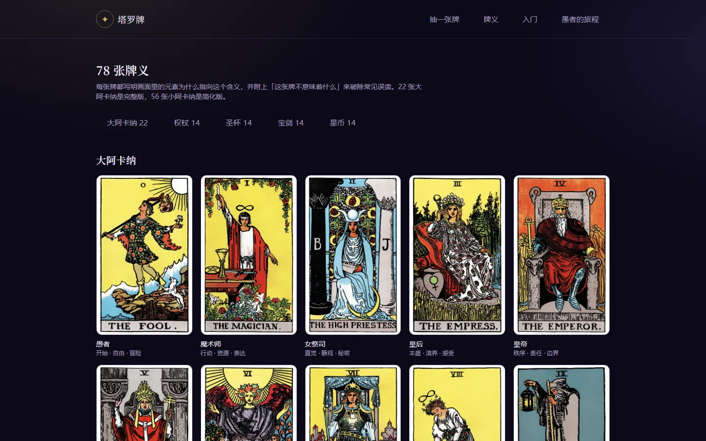

# 塔罗牌 · tarot-site

> 它不告诉你会发生什么，只帮你看清现在站在哪里。

一个把塔罗当作**自我觉察工具**的静态网站：在线抽牌 + 78 张牌义百科。  
不需要注册，不上传问题，所有解读都在浏览器里完成。

**在线访问：<https://3-dd-del.github.io/tarot-site/>**

<p align="center">
  <a href="https://3-dd-del.github.io/tarot-site/">
    
  </a>
</p>

<p align="center">
  
  
  
  <a href="https://3-dd-del.github.io/tarot-site/"></a>
  <a href="https://github.com/3-dd-del/tarot-site/actions/workflows/pages.yml"></a>
</p>

## 现在能做什么

- **完整的抽牌主流程**：选问题 → 确认 → 选牌阵 → 洗牌 → 逐张抽牌、翻牌 → 按牌位解读 → 反思问答（可跳过）→ 个性化解读 → 保存图片
- **三种牌阵**：单张牌、时间流、处境牌阵
- **正逆位**：洗牌时随机倒转；逆位只增加一段解读，不改变牌指向的方向，分享图也会同步旋转
- **78 张牌义页**：22 张大阿卡纳完整版，56 张小阿卡纳简化版，每张都包含画面、象征、通用含义、误区与分场景解读
- **入门内容**：7 节入门课 + 「愚者的旅程」22 站
- **内容安全边界**：生死与自伤问题会终止解读并给出求助渠道；健康、数字、赌博、违法等问题各有对应处理
- **零后端**：状态存在 `sessionStorage`，分享图在客户端 Canvas 生成，问题内容不上传
- **可安装**：带 Service Worker 与 Web App Manifest，可以像应用一样添加到桌面

## 三种牌阵

| 牌阵 | 牌位 | 适合用来 |
| --- | --- | --- |
| 单张牌 | 一张牌 | 快速看清此刻最值得注意的角度 |
| 时间流 | 过去 · 现在 · 未来 | 看一件事的来路、当下状态与可能走向 |
| 处境牌阵 | 现状 · 阻碍 · 建议 | 面对具体选择时，把处境拆开来看 |

抽牌结果独立于后续回答：回答只改变「落到你身上」的建议，不改变这张牌本身指向的方向。

## 页面一览

| 抽牌 | 牌义百科 |
| --- | --- |
| [](https://3-dd-del.github.io/tarot-site/read/) | [](https://3-dd-del.github.io/tarot-site/cards/) |
| 八个问题入口，也可以直接抽一张 | 78 张牌，按大阿卡纳与四个牌组浏览 |

## 内容与安全

这个网站不预测命运，也不替你做决定。它做的是：用一个具体问题进入，借 78 张牌的图像与象征，把模糊的感受说清楚一点。

对于高风险内容，前端有硬拦截，不依赖模型判断：

- **生死与自伤**：立即终止解读，给出 24 小时心理援助热线与紧急联系方式
- **健康、用药、检查结果**：不提供医疗判断，转译为「我可以怎样照顾自己」
- **彩票号码、股票涨跌、具体金额与日期**：不在塔罗能回答的范围内，直接说明边界
- **赌博与投注**：转译为「我为什么想赌」
- **违法与伤害他人**：终止解读，不作任何回应

> 这是一个文化、娱乐与自我觉察工具，不构成医疗、法律或投资建议。如果你正处在很困难的时刻，请优先联系专业人士或拨打当地紧急电话。

## 隐私

- 不登录、不收集账号，也没有后端数据库
- 问题与回答只保存在当前浏览器的 `sessionStorage`
- 分享图在本地 Canvas 绘制，图片不会经过服务器
- 清除浏览器站点数据即可删除所有本地记录

## 技术实现

| 部分 | 实现 |
| --- | --- |
| 框架 | Astro 7 + MDX，纯静态输出 |
| 样式 | Tailwind CSS 4 |
| 内容 | 78 张牌的数据与正文放在 `src/content/cards/`，构建时校验完整性 |
| 交互 | TypeScript 状态机 + 唯一客户端岛 `src/scripts/read-app.ts` |
| 本地状态 | `sessionStorage`，刷新后仍可继续当前牌局 |
| 分享图 | 客户端 Canvas 绘制，支持正逆位与长文本折行 |
| 离线 | Service Worker + Manifest，可安装为 PWA |
| 部署 | GitHub Pages；打标签发布静态包与容器镜像 |

## 本地运行

需要 **Node.js 22+** 与 **pnpm 11+**。

```bash
pnpm install
pnpm dev        # 开发预览，默认 http://localhost:4321
pnpm build      # 生成静态站点到 dist/
pnpm preview    # 预览构建产物
```

### Windows 桌面入口

先构建一次，再运行创建快捷方式的脚本：

```bash
pnpm build
powershell -ExecutionPolicy Bypass -File scripts\create-shortcut.ps1
```

桌面会出现「塔罗牌」图标，双击即可打开网站。入口调用 `scripts/serve.ps1`，只用 Windows 自带的 PowerShell 起本地静态服务，不需要额外安装 Node。关掉那个命令行窗口，服务就停了。

## 验证与测试

```bash
pnpm test       # 内容与文档校验（Node 内置测试）+ 单元测试（Vitest）
pnpm verify     # 构建 + 冒烟 + 端到端：逐路由校验，再用 jsdom 把抽牌流程从选问题跑到收尾
```

`pnpm test` 覆盖：

- 78 张牌是否齐全，frontmatter 与图片是否一一对应
- 章节结构是否完整，分场景含义是否覆盖全部一级问题分类
- 语境层占比、牌阵定义与牌位、逆位是否逐张接回自己的牌义
- 状态机迁移、当天重抽限制
- 禁忌分类与拦截等级
- 分享图内容与折行规则

## 部署

### GitHub Pages

推送到 `main` 会触发 `.github/workflows/pages.yml`：运行测试、构建、按子路径改写链接，然后发布到 <https://3-dd-del.github.io/tarot-site/>。

项目站点挂在 `/tarot-site/` 子路径下，而源码里使用的是根路径。构建之后由 `scripts/prefix-dist.mjs` 统一加上 `/tarot-site` 前缀，只修改构建产物，不影响源码、本地构建、Release 附件和容器镜像。

### Release 与容器镜像

推送 `v*` 标签会触发 `.github/workflows/release.yml`：

```bash
git tag v0.3.0
git push origin v0.3.0
```

它会运行测试与构建，产出：

- **Release 附件**：`tarot-site-dist.zip`，解压后可用任意静态服务器托管
- **容器镜像**：`ghcr.io/3-dd-del/tarot-site:0.3.0` 与 `:latest`

本地打镜像：

```bash
pnpm build
docker build -t tarot-site .
docker run --rm -p 8080:80 tarot-site
```

发布说明写在 [`RELEASE_NOTES.md`](RELEASE_NOTES.md)，每次发版前更新。

## 目录结构

```text
├── docs/                      # 产品设计、技术方案、素材来源、参考步骤
│   └── screenshots/           # README 截图
├── public/
│   ├── img/cards/             # 78 张牌面 WebP（800×1333）
│   └── sw.js                  # Service Worker
├── scripts/
│   ├── build-card-images.py   # 牌面转制
│   ├── make-icon.mjs          # 站点图标生成
│   ├── serve.ps1              # 桌面入口用的本地静态服务器
│   ├── create-shortcut.ps1    # 创建桌面快捷方式
│   ├── prefix-dist.mjs        # Pages 子路径前缀
│   └── smoke.mjs              # 构建产物冒烟测试
├── src/
│   ├── content/cards/         # 78 张牌数据（frontmatter + MDX 正文）
│   ├── content/learn/         # 入门路径 7 课
│   ├── lib/                   # 状态机、三层解读、禁忌拦截、随机抽牌、出图
│   ├── pages/                 # 首页 / read / cards / learn / journey / about
│   └── scripts/read-app.ts    # 抽牌岛，唯一的客户端脚本
└── tests/                     # 内容校验、单元测试、端到端
```

## 文档

- 产品方向、流程、占卜方法与用户旅程：[docs/product-design.md](docs/product-design.md)
- 技术方案与落地细节：[docs/tech-solution.md](docs/tech-solution.md)
- 牌面素材来源与许可：[docs/image-sources.md](docs/image-sources.md)
- 建站、部署与桌面入口的操作步骤：[docs/reference-steps.md](docs/reference-steps.md)

## 牌面来源

牌面使用 1909 年 Rider & Company 出版、Pamela Colman Smith 绘制的韦特体系塔罗，已进入公有领域。扫描与修复来自 [Steve P.](https://steve-p.org/cards/RWSa.html)，站内统一转制为 800×1333 WebP。

「Rider-Waite」「Rider-Waite-Smith」是美国游戏公司的注册商标，本站不使用这些名称作为站名或品牌标识。

## 关于

这个项目源自一个很具体的想法：把塔罗从「准不准」的焦虑里拿出来，变成一套可以自己使用的观察工具。牌面是入口，真正重要的部分是你如何回看自己的处境。

由 [@3-dd-del](https://github.com/3-dd-del) 设计与开发。  
在线访问：<https://3-dd-del.github.io/tarot-site/>
